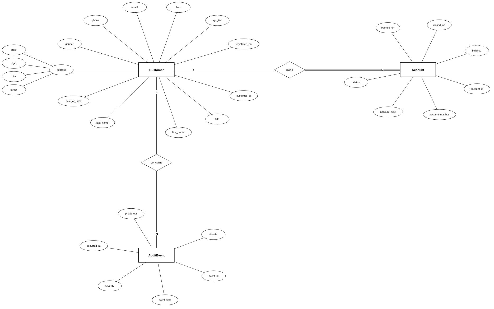
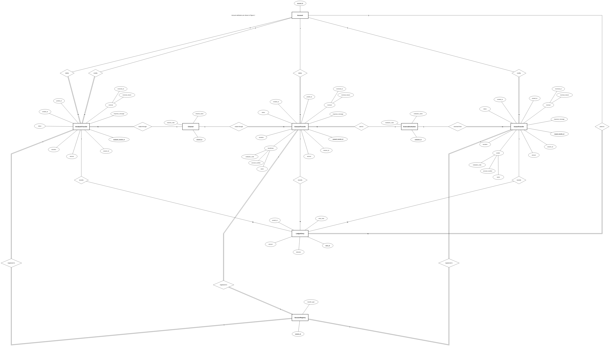

# Portfolio 1 Database Design and Modelling

## Requirements analysis

### Case study

Veracore MFB is a fictional Nigerian microfinance bank that offers Naira wallets and savings accounts through a mobile app, USSD and the web. The database stores customers, their accounts, and three kinds of transfer: intrabank transfers between Veracore accounts, inward transfers from accounts at other banks, and outward transfers to accounts at other banks. Every movement of money is recorded as ledger entries. It also stores the channel a customer used, the other banks, and security events such as failed logins and large transfers. Customer and transaction data is fictional, and other banks appear under their real names.

### Users

Customers open accounts and move money. Customer-support agents look up accounts and transfers. Operations staff handle reversals and frozen accounts. Auditors and compliance officers review the ledger and security events. A scheduled reconciliation job checks balances every day.

### Main operations

Open an account, make an intrabank transfer, receive an inward transfer from another bank, send an outward transfer to another bank, reverse a transfer, view a balance and statement, reconcile balances against the ledger, and record and review security events.

### Functional requirements

| ID | Requirement |
| --- | --- |
| FR1 | Register a customer and record their KYC tier. |
| FR2 | Open, freeze or close an account (wallet or savings) that belongs to a customer. |
| FR3 | Transfer funds between two Veracore accounts as one atomic operation (intrabank). |
| FR4 | Receive an inward transfer from an account at another bank into a Veracore account. |
| FR5 | Send an outward transfer from a Veracore account to an account at another bank. |
| FR6 | Reverse a successful transfer of any type once, without deleting its history. |
| FR7 | Show an account balance and a statement for a date range. |
| FR8 | Reconcile daily: each intrabank transfer nets to zero, each inward or outward transfer matches its single ledger entry, and the total of all balances equals money received from other banks minus money sent to them, after reversals. |
| FR9 | Record security events such as failed logins, large transfers and flags. |
| FR10 | Report on activity, for example failed transfers by channel and day, and the accounts with the highest volume. |

### Non-functional requirements

| ID | Requirement |
| --- | --- |
| NFR1 | Integrity: a transfer is applied completely or not at all. |
| NFR2 | Concurrency: simultaneous debits must not overdraw an account or spend the same money twice. |
| NFR3 | Auditability: the ledger is append-only and every change can be traced. |
| NFR4 | Performance: statement and recent-transfer lookups should use indexes on a large ledger. |
| NFR5 | Security: access is split by role (application, operations, read-only auditor). |
| NFR6 | Availability and recovery: the database tolerates the loss of one node and backups can be restored. |
| NFR7 | Scalability: the ledger grows fastest, so it should be possible to partition or shard it by account or date. |

### Business rules

1. Each customer has a unique customer ID and a unique phone number.
2. Each account belongs to exactly one customer, a customer can hold several accounts, and each account number is unique.
3. All amounts are in Naira with two decimal places, and every transfer amount is greater than zero.
4. An intrabank transfer's source and destination accounts must differ, and both must be active. An inward or outward transfer must involve an active Veracore account.
5. A customer account's balance must never fall below zero.
6. A successful intrabank transfer creates two ledger entries, a debit and a credit of equal amount, in the same transaction. A successful inward transfer creates one credit entry, and a successful outward transfer creates one debit entry.
7. Ledger entries are never updated or deleted.
8. Each transfer has a 30-digit session ID. A session ID is never used twice across intrabank, inward and outward transfers, so a repeated message cannot post twice.
9. A transfer starts as pending and ends as success or failed. A successful transfer of any type can be reversed once, by posting offsetting ledger entries on the same transfer, and its status then becomes reversed.
10. An account is active, frozen or closed. Only active accounts can be debited or credited, and an account can be closed only when its balance is zero.
11. The response message of a successful transfer is "Transaction is successful". The response message of a failed transfer gives the reason it failed.

### Scope

One institution, one currency (NGN), transfers between Veracore accounts, transfers received from accounts at other Nigerian banks and sent to them, and generated data. Cash deposits and withdrawals, loans, cards, interest, foreign exchange, real identity checks and user login are left out intentionally.

## Conceptual design

The model has ten entities, drawn in two figures. In the diagrams an underlined attribute identifies a record, a dashed ellipse is a derived attribute (calculated, not stored), and an ellipse with further ellipses attached is a composite attribute. Double lines mean every record of that entity must take part in the relationship. Single lines mean taking part is optional.

### Figure 1 Customers, accounts and security events

### Figure 2 Transfers, ledger, channels and other banks

### Entities and attributes

| Entity | Attributes |
| --- | --- |
| Customer | customer_id (key), title, first_name, last_name, date_of_birth, gender, phone, email, bvn, kyc_tier, registered_on, address (street, city, lga, state) |
| Account | account_id (key), account_number (unique), account_type, status, opened_on, closed_on, balance (derived) |
| AuditEvent | event_id (key), event_type, severity, occurred_at, ip_address, details |
| Channel | channel_id (key), channel_code (unique), channel_name |
| ExternalInstitution | institution_id (key), institution_code (unique), institution_name |
| IntrabankTransfer | intrabank_transfer_id (key), session_id, amount, narration, status, created_at, posted_at, response_message, reversal (reversed_at, reversal_reason) |
| InwardTransfer | inward_transfer_id (key), session_id, amount, narration, status, created_at, posted_at, response_message, sender (name, account_number, institution_code), reversal (reversed_at, reversal_reason) |
| OutwardTransfer | outward_transfer_id (key), session_id, amount, narration, status, created_at, posted_at, response_message, beneficiary (name, account_number, institution_code), reversal (reversed_at, reversal_reason) |
| SessionRegistry | session_id (key), transfer_type |
| LedgerEntry | entry_id (key), direction, amount, posted_at, entry_kind |

Gender is male or female, account_type is wallet or savings, account status is active, frozen or closed, transfer status is pending, success, failed or reversed, direction is debit or credit, and entry_kind is original or reversal. A session_id is a 30-digit number, and transfer_type in SessionRegistry is intrabank, inward or outward. Every entity has an id as its key. Account, Channel and ExternalInstitution also keep their business identifiers (account_number, channel_code and institution_code) as unique attributes. Balance is the sum of an account's ledger entries.

### Relationships

| Relationship | Entities | Cardinality | Participation |
| --- | --- | --- | --- |
| owns | Customer, Account | 1 : N | Every account has a customer. A customer may not have an account yet. |
| concerns | AuditEvent, Customer | N : 1 | Optional on both sides: an event may not be linked to a customer. |
| debits, credits | IntrabankTransfer, Account | N : 1 each | Every intrabank transfer has a source account and a destination account. |
| credits | InwardTransfer, Account | N : 1 | Every inward transfer is credited to one Veracore account. |
| debits | OutwardTransfer, Account | N : 1 | Every outward transfer is debited from one Veracore account. |
| received from | InwardTransfer, ExternalInstitution | N : 1 | Every inward transfer comes from one other bank. |
| sent to | OutwardTransfer, ExternalInstitution | N : 1 | Every outward transfer goes to one other bank. |
| made through | IntrabankTransfer or OutwardTransfer, Channel | N : 1 | Every intrabank and outward transfer is made through one channel. Inward transfers arrive from another bank, so they have no channel. |
| registered in | IntrabankTransfer, InwardTransfer or OutwardTransfer, SessionRegistry | 1 : 1 | Every transfer has exactly one registry row holding its session_id, and every registry row belongs to one transfer. SessionRegistry is what makes session_id unique across the three transfer tables, since a UNIQUE rule only works inside one table. |
| records | IntrabankTransfer, InwardTransfer or OutwardTransfer, LedgerEntry | 1 : N | A successful transfer has its ledger entries, plus reversal entries if it is reversed. A pending or failed transfer has none. |
| posts to | LedgerEntry, Account | N : 1 | Every entry affects one account. |

Every ledger entry belongs to exactly one transfer, which is an intrabank, inward or outward transfer. The diagram shows this as three separate links, and it cannot show that only one of them applies. The diagrams show structure only. Rules about values and behaviour, such as rules 4 to 9 and 11, are not drawn on them.
