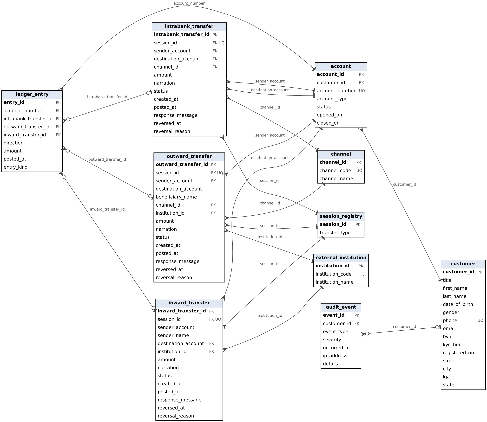
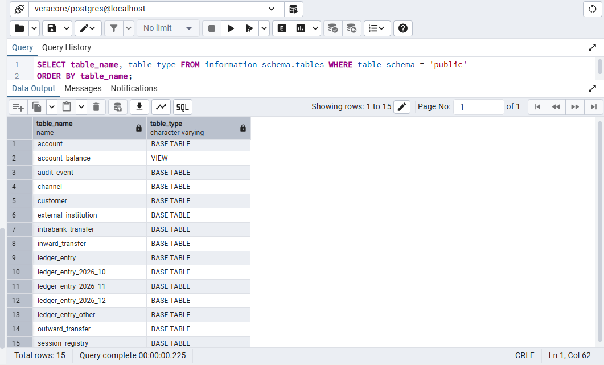
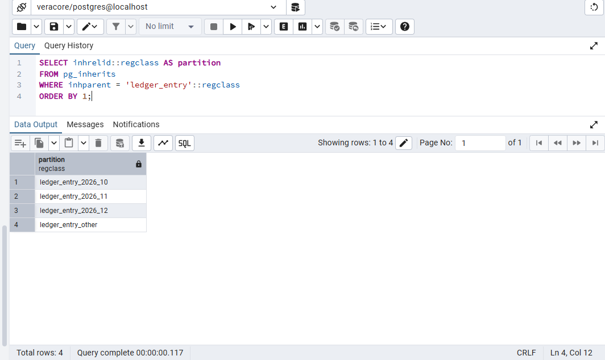
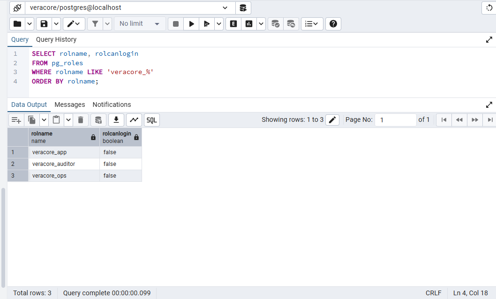
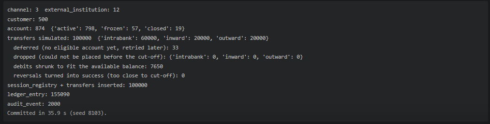
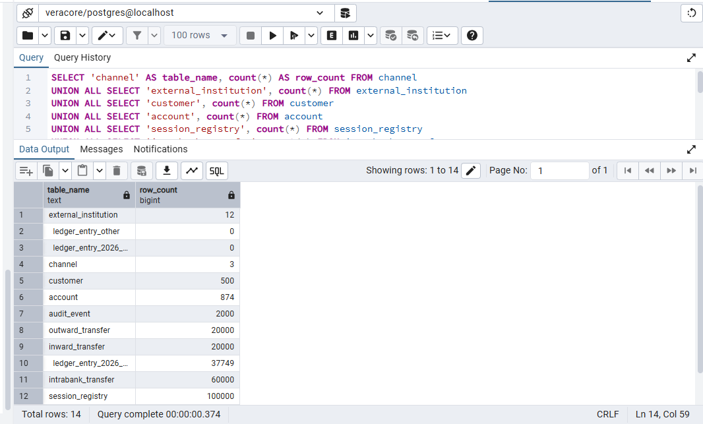
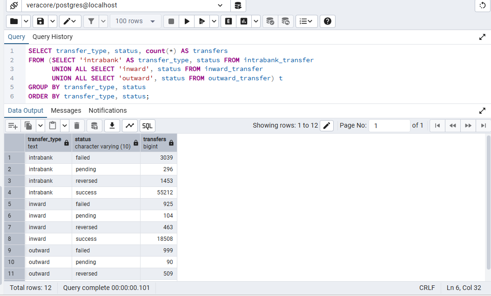
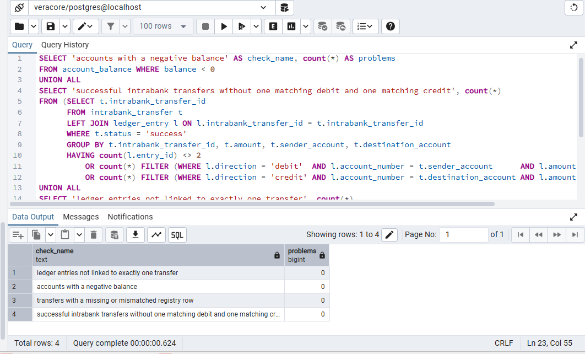
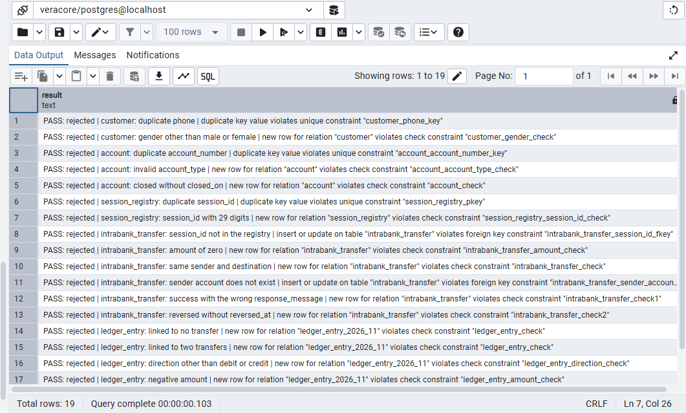
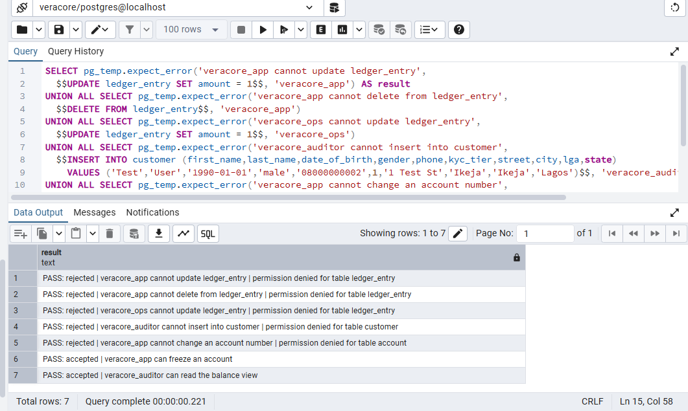

# Portfolio 1 Database Design and Modelling

## Requirements analysis

### Case study

Veracore MFB is a fictional Nigerian microfinance bank that offers Naira wallets and savings accounts through a mobile app, USSD and the web. The database stores customers, their accounts, and three kinds of transfer: intrabank transfers between Veracore accounts, inward transfers from accounts at other banks, and outward transfers to accounts at other banks. Every movement of money is recorded as ledger entries. It also stores the channel a customer used, the other banks, and security events such as failed logins and large transfers. Customer and transaction data is fictional, and other banks appear under their real names.

### Users

Customers open accounts and move money. Customer-support agents look up accounts and transfers. Operations staff handle reversals and frozen accounts. Auditors and compliance officers review the ledger and security events. A scheduled reconciliation job checks balances every day.

### Main operations

Open an account, make an intrabank transfer, receive an inward transfer from another bank, send an outward transfer to another bank, reverse a transfer, view a balance and statement, reconcile balances against the ledger, and record and review security events.

### Functional requirements

| ID | Requirement |
| --- | --- |
| FR1 | Register a customer and record their KYC tier. |
| FR2 | Open, freeze or close an account (wallet or savings) that belongs to a customer. |
| FR3 | Transfer funds between two Veracore accounts as one atomic operation (intrabank). |
| FR4 | Receive an inward transfer from an account at another bank into a Veracore account. |
| FR5 | Send an outward transfer from a Veracore account to an account at another bank. |
| FR6 | Reverse a successful transfer of any type once, without deleting its history. |
| FR7 | Show an account balance and a statement for a date range. |
| FR8 | Reconcile daily: each intrabank transfer nets to zero, each inward or outward transfer matches its single ledger entry, and the total of all balances equals money received from other banks minus money sent to them, after reversals. |
| FR9 | Record security events such as failed logins, large transfers and flags. |
| FR10 | Report on activity, for example failed transfers by channel and day, and the accounts with the highest volume. |

### Non-functional requirements

| ID | Requirement |
| --- | --- |
| NFR1 | Integrity: a transfer is applied completely or not at all. |
| NFR2 | Concurrency: simultaneous debits must not overdraw an account or spend the same money twice. |
| NFR3 | Auditability: the ledger is append-only and every change can be traced. |
| NFR4 | Performance: statement and recent-transfer lookups should use indexes on a large ledger. |
| NFR5 | Security: access is split by role (application, operations, read-only auditor). |
| NFR6 | Availability and recovery: the database tolerates the loss of one node and backups can be restored. |
| NFR7 | Scalability: the ledger grows fastest, so it should be possible to partition or shard it by account or date. |

### Business rules

1. Each customer has a unique customer ID and a unique phone number.
2. Each account belongs to exactly one customer, a customer can hold several accounts, and each account number is unique.
3. All amounts are in Naira with two decimal places, and every transfer amount is greater than zero.
4. An intrabank transfer's source and destination accounts must differ, and both must be active. An inward or outward transfer must involve an active Veracore account.
5. A customer account's balance must never fall below zero.
6. A successful intrabank transfer creates two ledger entries, a debit and a credit of equal amount, in the same transaction. A successful inward transfer creates one credit entry, and a successful outward transfer creates one debit entry.
7. Ledger entries are never updated or deleted.
8. Each transfer has a 30-digit session ID. A session ID is never used twice across intrabank, inward and outward transfers, so a repeated message cannot post twice.
9. A transfer starts as pending and ends as success or failed. A successful transfer of any type can be reversed once, by posting offsetting ledger entries on the same transfer, and its status then becomes reversed.
10. An account is active, frozen or closed. Only active accounts can be debited or credited, and an account can be closed only when its balance is zero.
11. The response message of a successful transfer is "Transaction is successful". The response message of a failed transfer gives the reason it failed.

### Scope

One institution, one currency (NGN), transfers between Veracore accounts, transfers received from accounts at other Nigerian banks and sent to them, and generated data. Cash deposits and withdrawals, loans, cards, interest, foreign exchange, real identity checks and user login are left out intentionally.

## Conceptual design

The model has ten entities, drawn in two figures. In the diagrams an underlined attribute identifies a record, a dashed ellipse is a derived attribute (calculated, not stored), and an ellipse with further ellipses attached is a composite attribute. Double lines mean every record of that entity must take part in the relationship. Single lines mean taking part is optional.

### Figure 1 Customers, accounts and security events

### Figure 2 Transfers, ledger, channels and other banks

### Entities and attributes

| Entity | Attributes |
| --- | --- |
| Customer | customer_id (key), title, first_name, last_name, date_of_birth, gender, phone, email, bvn, kyc_tier, registered_on, address (street, city, lga, state) |
| Account | account_id (key), account_number (unique), account_type, status, opened_on, closed_on, balance (derived) |
| AuditEvent | event_id (key), event_type, severity, occurred_at, ip_address, details |
| Channel | channel_id (key), channel_code (unique), channel_name |
| ExternalInstitution | institution_id (key), institution_code (unique), institution_name |
| IntrabankTransfer | intrabank_transfer_id (key), session_id, sender_account, destination_account, amount, narration, status, created_at, posted_at, response_message, reversal (reversed_at, reversal_reason) |
| InwardTransfer | inward_transfer_id (key), session_id, sender_account, sender_name, destination_account, amount, narration, status, created_at, posted_at, response_message, reversal (reversed_at, reversal_reason) |
| OutwardTransfer | outward_transfer_id (key), session_id, sender_account, destination_account, beneficiary_name, amount, narration, status, created_at, posted_at, response_message, reversal (reversed_at, reversal_reason) |
| SessionRegistry | session_id (key), transfer_type |
| LedgerEntry | entry_id (key), account_number, direction, amount, posted_at, entry_kind |

Gender is male or female, account_type is wallet or savings, account status is active, frozen or closed, transfer status is pending, success, failed or reversed, direction is debit or credit, and entry_kind is original or reversal. In a transfer, sender_account and destination_account hold account numbers. An account at Veracore must exist in Account, and an account at another bank is only stored as a number. A ledger entry holds the account number it affects. A session_id is a 30-digit number, and transfer_type in SessionRegistry is intrabank, inward or outward. Every entity has an id as its key. Account, Channel and ExternalInstitution also keep their business identifiers (account_number, channel_code and institution_code) as unique attributes. Balance is the sum of an account's ledger entries.

### Relationships

| Relationship | Entities | Cardinality | Participation |
| --- | --- | --- | --- |
| owns | Customer, Account | 1 : N | Every account has a customer. A customer may not have an account yet. |
| concerns | AuditEvent, Customer | N : 1 | Optional on both sides: an event may not be linked to a customer. |
| debits, credits | IntrabankTransfer, Account | N : 1 each | Every intrabank transfer has a source account and a destination account. |
| credits | InwardTransfer, Account | N : 1 | Every inward transfer is credited to one Veracore account. |
| debits | OutwardTransfer, Account | N : 1 | Every outward transfer is debited from one Veracore account. |
| received from | InwardTransfer, ExternalInstitution | N : 1 | Every inward transfer comes from one other bank. |
| sent to | OutwardTransfer, ExternalInstitution | N : 1 | Every outward transfer goes to one other bank. |
| made through | IntrabankTransfer or OutwardTransfer, Channel | N : 1 | Every intrabank and outward transfer is made through one channel. Inward transfers arrive from another bank, so they have no channel. |
| registered in | IntrabankTransfer, InwardTransfer or OutwardTransfer, SessionRegistry | 1 : 1 | Every transfer has exactly one registry row holding its session_id, and every registry row belongs to one transfer. SessionRegistry is what makes session_id unique across the three transfer tables, since a UNIQUE rule only works inside one table. |
| records | IntrabankTransfer, InwardTransfer or OutwardTransfer, LedgerEntry | 1 : N | A successful transfer has its ledger entries, plus reversal entries if it is reversed. A pending or failed transfer has none. |
| posts to | LedgerEntry, Account | N : 1 | Every entry affects one account. |

Every ledger entry belongs to exactly one transfer, which is an intrabank, inward or outward transfer. The diagram shows this as three separate links, and it cannot show that only one of them applies. The diagrams show structure only. Rules about values and behaviour, such as rules 4 to 9 and 11, are not drawn on them.

## Logical design

### Relational schema

Each entity became a table with its id as the primary key. Composite attributes became separate columns: address into street, city, lga and state, reversal into reversed_at and reversal_reason. Balance is derived, so it is not a column. Each one-to-many relationship became a foreign key on the many side. A transfer stores its sender and destination as account numbers, and a ledger entry stores the account number it affects. A Veracore account number is a foreign key to account_number, which is unique. An account number at another bank is a plain column, and institution_id identifies the bank. A ledger entry holds three optional foreign keys, one per transfer table, and exactly one of them is filled.

| Table | Primary key | Foreign keys | Also unique |
| --- | --- | --- | --- |
| customer | customer_id | none | phone |
| account | account_id | customer_id references customer | account_number |
| audit_event | event_id | customer_id references customer (optional) | none |
| channel | channel_id | none | channel_code |
| external_institution | institution_id | none | institution_code |
| session_registry | session_id | none | none |
| intrabank_transfer | intrabank_transfer_id | session_id references session_registry; sender_account and destination_account reference account (account_number); channel_id references channel | session_id |
| outward_transfer | outward_transfer_id | session_id references session_registry; sender_account references account (account_number); channel_id references channel; institution_id references external_institution | session_id |
| inward_transfer | inward_transfer_id | session_id references session_registry; destination_account references account (account_number); institution_id references external_institution | session_id |
| ledger_entry | entry_id | account_number references account (account_number); intrabank_transfer_id, outward_transfer_id and inward_transfer_id reference their transfer tables (each optional) | none |

### Constraints

Every foreign key is required except the ones marked optional. No foreign key cascades a delete, because transfers and ledger entries are never deleted.

| Table | Constraint | Rule |
| --- | --- | --- |
| customer | phone is required and unique; gender is male or female | 1 |
| account | account_type is wallet or savings; status is active, frozen or closed; closed_on is filled only when status is closed, and always when it is | 2, 10 |
| session_registry | session_id is exactly 30 digits; transfer_type is intrabank, inward or outward | 8 |
| the three transfer tables | amount is greater than zero; status is pending, success, failed or reversed; response_message is "Transaction is successful" when status is success; reversed_at and reversal_reason are filled when status is reversed and empty otherwise | 3, 9, 11 |
| intrabank_transfer | sender_account and destination_account differ | 4 |
| outward_transfer, inward_transfer | the account number at the other bank (destination_account, sender_account) is exactly 10 digits | 2 |
| ledger_entry | direction is debit or credit; entry_kind is original or reversal; amount is greater than zero; exactly one of the three transfer ids is filled | 3, 6 |

Some rules involve other rows or other tables, so a column or row check cannot hold them: the active-account condition in rule 4, rule 5, the pairing of debit and credit entries in rule 6, rule 7, the match between transfer_type in the registry and the table that holds the transfer, and the zero-balance condition for closing an account in rule 10.

### Normalisation

I started from a flat report of outward transfers. The values are made up for the example, and the session IDs are shortened.

| session_id | customer_id | customer_name | account_number | account_type | channel_code | channel_name | bank_name | ledger_entries |
| --- | --- | --- | --- | --- | --- | --- | --- | --- |
| T1 | C1 | Ada Okoro | 1000000001 | savings | MOB | Mobile app | Access Bank | debit 25,000.00 |
| T2 | C1 | Ada Okoro | 1000000001 | savings | USSD | USSD | GTBank | debit 10,000.00 |
| T3 | C2 | Tunde Bello | 1000000002 | wallet | MOB | Mobile app | Access Bank | debit 7,500.00; credit 7,500.00 (reversal) |

The dependencies in this data are:

- session_id determines account_number, channel_code and bank_name, since a transfer has one source account, one channel and one bank.
- account_number determines customer_id and account_type.
- customer_id determines customer_name.
- channel_code determines channel_name.

**First normal form.** The ledger_entries cell of T3 holds two values. Each entry gets its own row, numbered within its transfer, so the key becomes session_id with entry_no.

**Second normal form.** direction, amount and entry_kind depend on the whole key. The customer, account, channel and bank columns depend on session_id alone, which is a partial dependency. They move to a transfer table, and the entries stay in their own table.

| session_id | entry_no | direction | amount | entry_kind |
| --- | --- | --- | --- | --- |
| T1 | 1 | debit | 25,000.00 | original |
| T2 | 1 | debit | 10,000.00 | original |
| T3 | 1 | debit | 7,500.00 | original |
| T3 | 2 | credit | 7,500.00 | reversal |

**Third normal form.** In the transfer table, customer_id and account_type depend on account_number, customer_name depends on customer_id, and channel_name depends on channel_code. Each of these depends on a column that is not the key, which is a transitive dependency. The table splits into transfer (session_id, account_number, channel_code, bank_name), account (account_number, customer_id, account_type), customer (customer_id, customer_name) and channel (channel_code, channel_name). Bank details get their own table in the same way.

**Boyce-Codd normal form.** In each of these tables the only determinants are candidate keys. In the final schema, account_id and account_number both identify an account, and session_id and the transfer id both identify a transfer. Either one is a candidate key, so no determinant falls outside a key and the tables are in BCNF.

I checked whether lga determines state in the customer address, which would be a transitive dependency. It does not, because some LGA names exist in more than one state, for example Surulere in Lagos and in Oyo. The address columns stay in customer.

The final schema above is the result. The generated ids replace the business columns as primary keys, and account_number, channel_code and institution_code stay as unique columns. Balance is not stored, so it cannot disagree with the ledger.

## Physical design

The schema is in [Awa_Emmanuel_301914400_P1_Schema.sql](Awa_Emmanuel_301914400_P1_Schema.sql). I chose PostgreSQL because the case study depends on transactions, foreign keys, check constraints, partitioning and role-based access, and it provides all of them.

### Data types

| Data | Type | Reason |
| --- | --- | --- |
| ids | bigint, generated always as identity | The database assigns them, and the ledger can grow past the integer range. |
| amounts | numeric(18,2) | Exact Naira and kobo values. A floating-point type would round. |
| times | timestamptz | Transfers and entries need an unambiguous moment. |
| session_id | char(30) with a digits-only check | Fixed length, as in rule 8. |
| account and bank account numbers, bvn | char(10), char(11) with digits-only checks | Nigerian account numbers have 10 digits and a BVN has 11. |
| status, type and direction values | varchar with a check constraint | A check list is simpler to change than an enum type. |
| ip_address | inet | Validates the address. |

### Storage

ledger_entry is the table that grows fastest, so it is partitioned by month on posted_at. Its primary key is entry_id with posted_at, because a partition key has to be part of the primary key. There are partitions for October, November and December 2026, and a default partition for any other date. An old month can be detached and archived without touching the rest.

### Indexes

PostgreSQL creates an index for every primary key and unique constraint: the ten primary keys, plus phone, account_number, channel_code, institution_code, and session_id on each transfer table. No other indexes exist yet.

### Views

account_balance returns each account with its balance, summed from the ledger as credits minus debits. A reversal posts the opposite direction, so it cancels the original entry.

### Security

The three roles cannot log in. Each user or service account is later granted one of them.

| Role | Access |
| --- | --- |
| veracore_app | Read and insert on customers, accounts, transfers, the registry, audit events and the ledger. Read on channels, banks and balances. Update only account status and closing date, and the status and reversal columns of the transfer tables. |
| veracore_ops | Read on all tables. Update account status and closing date, and the status and reversal columns of the transfer tables. |
| veracore_auditor | Read on all tables. |

No role is granted update or delete on ledger_entry, which is how rule 7 is applied.

## Implementation

I loaded the schema into a PostgreSQL database called veracore and filled it with generated data using [Awa_Emmanuel_301914400_P1_SeedData.py](Awa_Emmanuel_301914400_P1_SeedData.py). The script uses a fixed random seed (8103), so a rerun produces the same data. The load took 35.9 seconds.

### Schema in the database

The tables, partitions and view created by the schema file:

The four partitions of ledger_entry:

The three roles:

### Seed data

The seed script's own summary of the load:

The data is fictional. Names, phone numbers, BVNs and account numbers are generated, and the banks are real Nigerian banks. Transfers run in time order from 1 October to 10 November 2026. Every active account first receives an inward transfer, and a debit is reduced when the balance would not cover it. The script reduced 7,650 debits this way. It held back 33 transfers until an eligible account existed and dropped none. Frozen and closed accounts have no transfers.

| Table | Rows |
| --- | --- |
| channel | 3 |
| external_institution | 12 |
| customer | 500 |
| account | 874 (798 active, 57 frozen, 19 closed) |
| session_registry | 100,000 |
| intrabank_transfer | 60,000 |
| inward_transfer | 20,000 |
| outward_transfer | 20,000 |
| ledger_entry | 155,090 |
| audit_event | 2,000 |

The ledger rows sit in the October partition (117,341) and the November partition (37,749). The December and default partitions are empty.

| Transfer type | Success | Failed | Pending | Reversed |
| --- | --- | --- | --- | --- |
| intrabank | 55,212 | 3,039 | 296 | 1,453 |
| inward | 18,508 | 925 | 104 | 463 |
| outward | 18,402 | 999 | 90 | 509 |

### Checks after loading

Each check counts rows that break a rule, so 0 is the expected result. All four returned 0.

| Check | Result |
| --- | --- |
| Accounts with a negative balance | 0 |
| Successful intrabank transfers without one matching debit and one matching credit | 0 |
| Ledger entries not linked to exactly one transfer | 0 |
| Transfers with a missing or mismatched registry row | 0 |

## Testing and evaluation

### Constraint tests

I ran each test as a single statement inside a block that is always rolled back, so no test changed the data. The first 18 tests are statements that break a rule and should be rejected. The last is a valid transfer and should be accepted. All 19 gave the expected result.

| Test | Result |
| --- | --- |
| customer: duplicate phone | rejected, customer_phone_key |
| customer: gender other than male or female | rejected, customer_gender_check |
| account: duplicate account_number | rejected, account_account_number_key |
| account: invalid account_type | rejected, account_account_type_check |
| account: closed without closed_on | rejected, account_check |
| session_registry: duplicate session_id | rejected, session_registry_pkey |
| session_registry: session_id with 29 digits | rejected, session_registry_session_id_check |
| intrabank_transfer: session_id not in the registry | rejected, intrabank_transfer_session_id_fkey |
| intrabank_transfer: amount of zero | rejected, intrabank_transfer_amount_check |
| intrabank_transfer: same sender and destination | rejected, intrabank_transfer_check |
| intrabank_transfer: sender account does not exist | rejected, intrabank_transfer_sender_account_fkey |
| intrabank_transfer: success with the wrong response_message | rejected, intrabank_transfer_check1 |
| intrabank_transfer: reversed without reversed_at | rejected, intrabank_transfer_check2 |
| ledger_entry: linked to no transfer | rejected, ledger_entry_check |
| ledger_entry: linked to two transfers | rejected, ledger_entry_check |
| ledger_entry: direction other than debit or credit | rejected, ledger_entry_direction_check |
| ledger_entry: negative amount | rejected, ledger_entry_amount_check |
| ledger_entry: account number does not exist | rejected, ledger_entry_account_number_fkey |
| valid intrabank transfer | accepted |

### Access tests

I ran each statement as the role named in the test, again inside a rolled-back block. All seven gave the expected result.

| Test | Result |
| --- | --- |
| veracore_app updates ledger_entry | rejected, permission denied |
| veracore_app deletes from ledger_entry | rejected, permission denied |
| veracore_ops updates ledger_entry | rejected, permission denied |
| veracore_auditor inserts into customer | rejected, permission denied |
| veracore_app changes an account number | rejected, permission denied |
| veracore_app freezes an account | accepted |
| veracore_auditor reads account_balance | accepted |

### Evaluation

The constraints reject bad values, broken references, duplicate keys and malformed transfers, and the roles keep the ledger from being changed by the application, operations or auditor roles. The checks after loading showed that the seeded data keeps balances at or above zero and pairs every successful intrabank transfer with one debit and one credit.

Some rules are not enforced by the schema, because they depend on other rows or tables. The database does not stop a transfer involving an account that is frozen or closed, a debit that takes a balance below zero, a successful transfer with missing ledger entries, or a registry transfer_type that differs from the table holding the transfer. It also does not stop an account from being closed with a balance. The owner of the tables can still update the ledger, since the restriction applies to the three roles. These rules are checked in the data after loading and are not tested as rejections.
