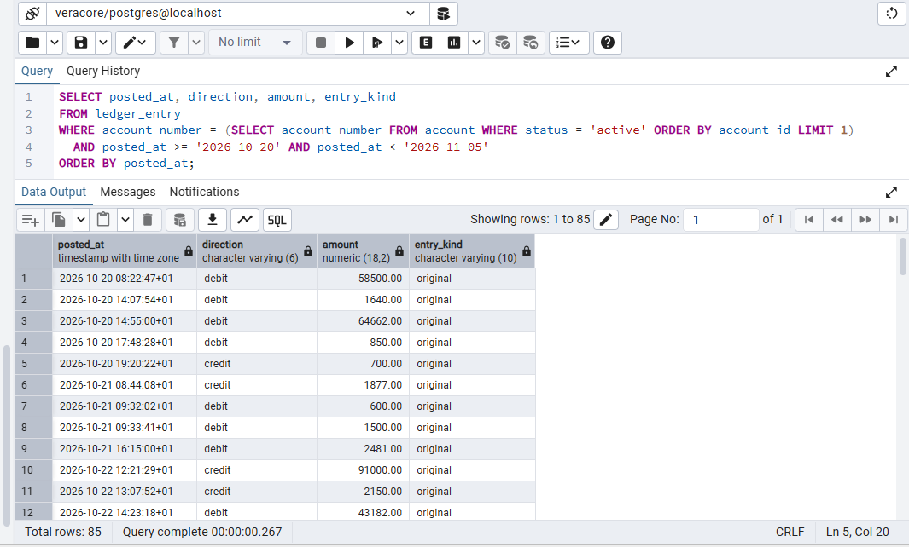
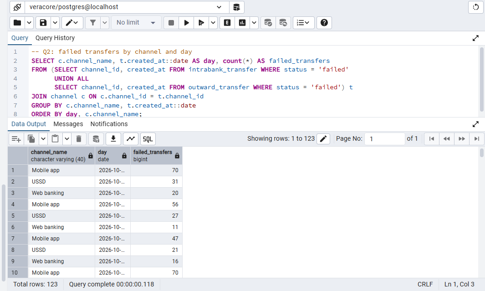
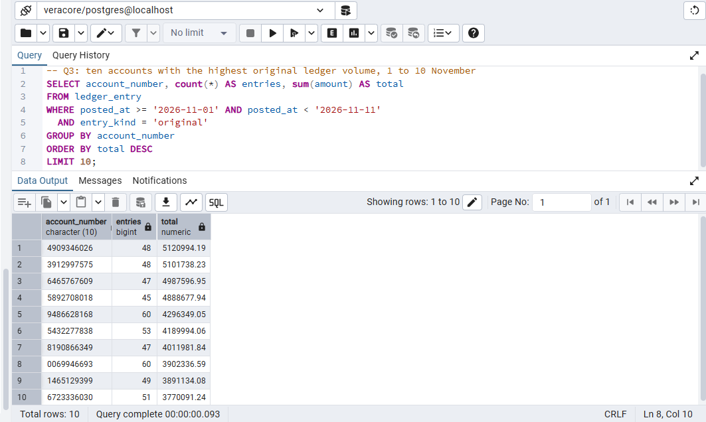
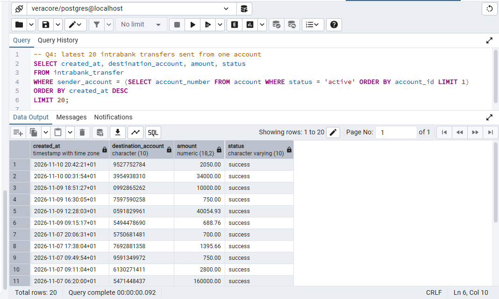
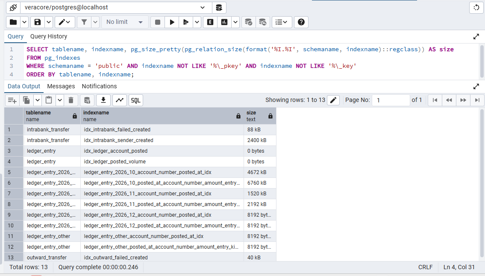

# Portfolio 2 Query Processing and Optimisation

## Approach

I ran four queries on the veracore database from Portfolio 1, which holds 155,090 ledger entries, 60,000 intrabank transfers and 20,000 outward transfers. Each query was run with `EXPLAIN (ANALYZE, BUFFERS)` before any index beyond the key indexes existed, then again after I created five indexes. Each was run twice and I kept the second run, so the data was already in memory. The queries and the index definitions are in [Awa_Emmanuel_301914400_P2_Queries.sql](Awa_Emmanuel_301914400_P2_Queries.sql).

## Indexes

```sql
CREATE INDEX idx_ledger_account_posted ON ledger_entry (account_number, posted_at);
CREATE INDEX idx_intrabank_sender_created ON intrabank_transfer (sender_account, created_at DESC);
CREATE INDEX idx_intrabank_failed_created ON intrabank_transfer (created_at) WHERE status = 'failed';
CREATE INDEX idx_outward_failed_created ON outward_transfer (created_at) WHERE status = 'failed';
CREATE INDEX idx_ledger_posted_volume ON ledger_entry (posted_at) INCLUDE (account_number, amount, entry_kind);
```

The two failed-transfer indexes are partial, so they hold only the failed rows. The index on ledger_entry is created on the partitioned table, so each partition gets its own copy.

## Query 1: statement for one account

A statement for one active account over 20 October to 5 November, which crosses two partitions (FR7).

```
SELECT posted_at, direction, amount, entry_kind
FROM ledger_entry
WHERE account_number = (SELECT account_number FROM account WHERE status = 'active' ORDER BY account_id LIMIT 1)
  AND posted_at >= '2026-10-20' AND posted_at < '2026-11-05'
ORDER BY posted_at;
```

[](screenshots/Awa_Emmanuel_301914400_P2_Q1Result.png)

Plan before the indexes:

```
Gather Merge  (cost=4666.83..4675.69 rows=76 width=29) (actual time=147.848..160.055 rows=85.00 loops=1)
  Workers Planned: 2
  Workers Launched: 2
  Buffers: shared hit=2148
  InitPlan 1
    ->  Limit  (cost=0.28..0.33 rows=1 width=19) (actual time=0.037..0.038 rows=1.00 loops=1)
          Buffers: shared hit=3
          ->  Index Scan using account_pkey on account  (cost=0.28..47.57 rows=798 width=19) (actual time=0.036..0.036 rows=1.00 loops=1)
                Filter: ((status)::text = 'active'::text)
                Index Searches: 1
                Buffers: shared hit=3
  ->  Sort  (cost=3666.47..3666.55 rows=32 width=29) (actual time=7.124..7.126 rows=28.33 loops=3)
        Sort Key: ledger_entry.posted_at
        Sort Method: quicksort  Memory: 28kB
        Buffers: shared hit=2145
        Worker 0:  Sort Method: quicksort  Memory: 25kB
        Worker 1:  Sort Method: quicksort  Memory: 25kB
        ->  Parallel Append  (cost=0.00..3665.67 rows=32 width=29) (actual time=0.034..6.927 rows=28.33 loops=3)
              Buffers: shared hit=2069
              ->  Parallel Seq Scan on ledger_entry_2026_10 ledger_entry_1  (cost=0.00..2772.92 rows=34 width=29) (actual time=7.911..15.318 rows=63.00 loops=1)
                    Filter: ((posted_at >= '2026-10-20 00:00:00+01'::timestamp with time zone) AND (posted_at < '2026-11-05 00:00:00+01'::timestamp with time zone) AND (account_number = (InitPlan 1).col1))
                    Rows Removed by Filter: 117278
                    Buffers: shared hit=1565
              ->  Parallel Seq Scan on ledger_entry_2026_11 ledger_entry_2  (cost=0.00..892.59 rows=11 width=29) (actual time=0.097..5.439 rows=22.00 loops=1)
                    Filter: ((posted_at >= '2026-10-20 00:00:00+01'::timestamp with time zone) AND (posted_at < '2026-11-05 00:00:00+01'::timestamp with time zone) AND (account_number = (InitPlan 1).col1))
                    Rows Removed by Filter: 37727
                    Buffers: shared hit=504
Planning Time: 0.440 ms
Execution Time: 160.125 ms
```

Plan after the indexes:

```
Sort  (cost=271.37..271.56 rows=76 width=29) (actual time=0.168..0.171 rows=85.00 loops=1)
  Sort Key: ledger_entry.posted_at
  Sort Method: quicksort  Memory: 28kB
  Buffers: shared hit=88
  InitPlan 1
    ->  Limit  (cost=0.28..0.33 rows=1 width=19) (actual time=0.012..0.012 rows=1.00 loops=1)
          Buffers: shared hit=3
          ->  Index Scan using account_pkey on account  (cost=0.28..47.57 rows=798 width=19) (actual time=0.011..0.011 rows=1.00 loops=1)
                Filter: ((status)::text = 'active'::text)
                Index Searches: 1
                Buffers: shared hit=3
  ->  Append  (cost=5.14..268.66 rows=76 width=29) (actual time=0.055..0.154 rows=85.00 loops=1)
        Buffers: shared hit=88
        ->  Bitmap Heap Scan on ledger_entry_2026_10 ledger_entry_1  (cost=5.14..198.36 rows=57 width=29) (actual time=0.055..0.111 rows=63.00 loops=1)
              Recheck Cond: ((account_number = (InitPlan 1).col1) AND (posted_at >= '2026-10-20 00:00:00+01'::timestamp with time zone) AND (posted_at < '2026-11-05 00:00:00+01'::timestamp with time zone))
              Heap Blocks: exact=59
              Buffers: shared hit=65
              ->  Bitmap Index Scan on ledger_entry_2026_10_account_number_posted_at_idx  (cost=0.00..5.13 rows=57 width=0) (actual time=0.037..0.037 rows=63.00 loops=1)
                    Index Cond: ((account_number = (InitPlan 1).col1) AND (posted_at >= '2026-10-20 00:00:00+01'::timestamp with time zone) AND (posted_at < '2026-11-05 00:00:00+01'::timestamp with time zone))
                    Index Searches: 1
                    Buffers: shared hit=6
        ->  Bitmap Heap Scan on ledger_entry_2026_11 ledger_entry_2  (cost=4.66..69.92 rows=19 width=29) (actual time=0.019..0.036 rows=22.00 loops=1)
              Recheck Cond: ((account_number = (InitPlan 1).col1) AND (posted_at >= '2026-10-20 00:00:00+01'::timestamp with time zone) AND (posted_at < '2026-11-05 00:00:00+01'::timestamp with time zone))
              Heap Blocks: exact=20
              Buffers: shared hit=23
              ->  Bitmap Index Scan on ledger_entry_2026_11_account_number_posted_at_idx  (cost=0.00..4.65 rows=19 width=0) (actual time=0.011..0.011 rows=22.00 loops=1)
                    Index Cond: ((account_number = (InitPlan 1).col1) AND (posted_at >= '2026-10-20 00:00:00+01'::timestamp with time zone) AND (posted_at < '2026-11-05 00:00:00+01'::timestamp with time zone))
                    Index Searches: 1
                    Buffers: shared hit=3
Planning:
  Buffers: shared hit=8
Planning Time: 0.383 ms
Execution Time: 0.202 ms
```

Before, each of the two partitions was read in full with a parallel sequential scan. The October scan discarded 117,278 rows and the November scan 37,727 to return 85 rows. After, each partition uses a bitmap index scan on its account_number and posted_at index and reads only the matching pages. Buffers fell from 2,148 to 88, and execution time fell from 160.125 ms to 0.202 ms, about 790 times faster. The December and default partitions are not scanned in either plan.

## Query 2: failed transfers by channel and day

Failed intrabank and outward transfers counted by channel and day (FR10).

```
SELECT c.channel_name, t.created_at::date AS day, count(*) AS failed_transfers
FROM (SELECT channel_id, created_at FROM intrabank_transfer WHERE status = 'failed'
      UNION ALL
      SELECT channel_id, created_at FROM outward_transfer WHERE status = 'failed') t
JOIN channel c ON c.channel_id = t.channel_id
GROUP BY c.channel_name, t.created_at::date
ORDER BY day, c.channel_name;
```

[](screenshots/Awa_Emmanuel_301914400_P2_Q2Result.png)

Plan before the indexes:

```
GroupAggregate  (cost=2991.97..2993.34 rows=61 width=21) (actual time=15.470..15.942 rows=123.00 loops=1)
  Group Key: (("*SELECT* 1".created_at)::date), c.channel_name
  Buffers: shared hit=1918
  ->  Sort  (cost=2991.97..2992.12 rows=61 width=13) (actual time=15.454..15.570 rows=4038.00 loops=1)
        Sort Key: (("*SELECT* 1".created_at)::date), c.channel_name
        Sort Method: quicksort  Memory: 223kB
        Buffers: shared hit=1918
        ->  Hash Join  (cost=1.07..2990.16 rows=61 width=13) (actual time=0.056..13.885 rows=4038.00 loops=1)
              Hash Cond: ("*SELECT* 1".channel_id = c.channel_id)
              Buffers: shared hit=1918
              ->  Append  (cost=0.00..2978.03 rows=4069 width=16) (actual time=0.031..12.058 rows=4038.00 loops=1)
                    Buffers: shared hit=1917
                    ->  Subquery Scan on "*SELECT* 1"  (cost=0.00..2170.70 rows=3070 width=16) (actual time=0.030..9.386 rows=3039.00 loops=1)
                          Buffers: shared hit=1390
                          ->  Seq Scan on intrabank_transfer  (cost=0.00..2140.00 rows=3070 width=16) (actual time=0.029..9.064 rows=3039.00 loops=1)
                                Filter: ((status)::text = 'failed'::text)
                                Rows Removed by Filter: 56961
                                Buffers: shared hit=1390
                    ->  Subquery Scan on "*SELECT* 2"  (cost=0.00..786.99 rows=999 width=16) (actual time=0.052..2.342 rows=999.00 loops=1)
                          Buffers: shared hit=527
                          ->  Seq Scan on outward_transfer  (cost=0.00..777.00 rows=999 width=16) (actual time=0.051..2.270 rows=999.00 loops=1)
                                Filter: ((status)::text = 'failed'::text)
                                Rows Removed by Filter: 19001
                                Buffers: shared hit=527
              ->  Hash  (cost=1.03..1.03 rows=3 width=17) (actual time=0.013..0.013 rows=3.00 loops=1)
                    Buckets: 1024  Batches: 1  Memory Usage: 9kB
                    Buffers: shared hit=1
                    ->  Seq Scan on channel c  (cost=0.00..1.03 rows=3 width=17) (actual time=0.008..0.009 rows=3.00 loops=1)
                          Buffers: shared hit=1
Planning Time: 0.329 ms
Execution Time: 16.078 ms
```

Plan after the indexes:

```
GroupAggregate  (cost=298.51..299.83 rows=59 width=21) (actual time=6.403..6.866 rows=123.00 loops=1)
  Group Key: (("*SELECT* 1".created_at)::date), c.channel_name
  Buffers: shared hit=1711
  ->  Sort  (cost=298.51..298.65 rows=59 width=13) (actual time=6.389..6.500 rows=4038.00 loops=1)
        Sort Key: (("*SELECT* 1".created_at)::date), c.channel_name
        Sort Method: quicksort  Memory: 223kB
        Buffers: shared hit=1711
        ->  Hash Join  (cost=1.35..296.77 rows=59 width=13) (actual time=0.136..5.024 rows=4038.00 loops=1)
              Hash Cond: ("*SELECT* 1".channel_id = c.channel_id)
              Buffers: shared hit=1711
              ->  Append  (cost=0.28..285.03 rows=3925 width=16) (actual time=0.056..3.661 rows=4038.00 loops=1)
                    Buffers: shared hit=1710
                    ->  Subquery Scan on "*SELECT* 1"  (cost=0.28..190.00 rows=2926 width=16) (actual time=0.055..2.903 rows=3039.00 loops=1)
                          Buffers: shared hit=1239
                          ->  Index Scan using idx_intrabank_failed_created on intrabank_transfer  (cost=0.28..160.74 rows=2926 width=16) (actual time=0.053..2.641 rows=3039.00 loops=1)
                                Index Searches: 1
                                Buffers: shared hit=1239
                    ->  Subquery Scan on "*SELECT* 2"  (cost=0.28..75.40 rows=999 width=16) (actual time=0.014..0.524 rows=999.00 loops=1)
                          Buffers: shared hit=471
                          ->  Index Scan using idx_outward_failed_created on outward_transfer  (cost=0.28..65.41 rows=999 width=16) (actual time=0.014..0.465 rows=999.00 loops=1)
                                Index Searches: 1
                                Buffers: shared hit=471
              ->  Hash  (cost=1.03..1.03 rows=3 width=17) (actual time=0.030..0.030 rows=3.00 loops=1)
                    Buckets: 1024  Batches: 1  Memory Usage: 9kB
                    Buffers: shared hit=1
                    ->  Seq Scan on channel c  (cost=0.00..1.03 rows=3 width=17) (actual time=0.021..0.022 rows=3.00 loops=1)
                          Buffers: shared hit=1
Planning Time: 0.321 ms
Execution Time: 6.992 ms
```

Before, both transfer tables were read in full and filtered on status. After, the partial indexes let the planner visit only the failed rows, using idx_intrabank_failed_created and idx_outward_failed_created. The index holds only created_at, so the planner still reads each failed row from the table to get channel_id. That is why buffers fell only from 1,918 to 1,711, while execution time fell from 16.078 ms to 6.992 ms, about 2.3 times faster. Both plans pass 4,038 rows to the aggregation.

## Query 3: accounts with the highest volume

The ten accounts with the highest original ledger volume from 1 to 10 November (FR10).

```
SELECT account_number, count(*) AS entries, sum(amount) AS total
FROM ledger_entry
WHERE posted_at >= '2026-11-01' AND posted_at < '2026-11-11'
  AND entry_kind = 'original'
GROUP BY account_number
ORDER BY total DESC
LIMIT 10;
```

[](screenshots/Awa_Emmanuel_301914400_P2_Q3Result.png)

Plan before the indexes:

```
Limit  (cost=1467.04..1467.06 rows=10 width=51) (actual time=19.992..19.995 rows=10.00 loops=1)
  Buffers: shared hit=504
  ->  Sort  (cost=1467.04..1469.03 rows=798 width=51) (actual time=19.991..19.993 rows=10.00 loops=1)
        Sort Key: (sum(ledger_entry.amount)) DESC
        Sort Method: top-N heapsort  Memory: 26kB
        Buffers: shared hit=504
        ->  HashAggregate  (cost=1439.82..1449.79 rows=798 width=51) (actual time=19.619..19.835 rows=798.00 loops=1)
              Group Key: ledger_entry.account_number
              Batches: 1  Memory Usage: 353kB
              Buffers: shared hit=504
              ->  Seq Scan on ledger_entry_2026_11 ledger_entry  (cost=0.00..1164.61 rows=36695 width=17) (actual time=0.036..8.727 rows=36690.00 loops=1)
                    Filter: ((posted_at >= '2026-11-01 00:00:00+01'::timestamp with time zone) AND (posted_at < '2026-11-11 00:00:00+01'::timestamp with time zone) AND ((entry_kind)::text = 'original'::text))
                    Rows Removed by Filter: 1059
                    Buffers: shared hit=504
Planning Time: 0.519 ms
Execution Time: 20.158 ms
```

Plan after the indexes:

```
Limit  (cost=1467.05..1467.07 rows=10 width=51) (actual time=20.993..20.995 rows=10.00 loops=1)
  Buffers: shared hit=504
  ->  Sort  (cost=1467.05..1469.04 rows=798 width=51) (actual time=20.991..20.992 rows=10.00 loops=1)
        Sort Key: (sum(ledger_entry.amount)) DESC
        Sort Method: top-N heapsort  Memory: 26kB
        Buffers: shared hit=504
        ->  HashAggregate  (cost=1439.83..1449.80 rows=798 width=51) (actual time=20.614..20.824 rows=798.00 loops=1)
              Group Key: ledger_entry.account_number
              Batches: 1  Memory Usage: 353kB
              Buffers: shared hit=504
              ->  Seq Scan on ledger_entry_2026_11 ledger_entry  (cost=0.00..1164.61 rows=36696 width=17) (actual time=0.026..8.994 rows=36690.00 loops=1)
                    Filter: ((posted_at >= '2026-11-01 00:00:00+01'::timestamp with time zone) AND (posted_at < '2026-11-11 00:00:00+01'::timestamp with time zone) AND ((entry_kind)::text = 'original'::text))
                    Rows Removed by Filter: 1059
                    Buffers: shared hit=504
Planning:
  Buffers: shared hit=9
Planning Time: 0.369 ms
Execution Time: 21.168 ms
```

The two plans are the same. Both scan only ledger_entry_2026_11, because the date range lets PostgreSQL skip every other partition. The planner did not use idx_ledger_posted_volume. The scan keeps 36,690 of the 37,749 rows in that partition, so reading the partition once is cheaper than going through an index. Execution time went from 20.158 ms to 21.168 ms. The plans are identical, so I treat the one millisecond difference as variation between runs.

## Query 4: latest transfers from one account

The latest 20 intrabank transfers sent from one active account.

```
SELECT created_at, destination_account, amount, status
FROM intrabank_transfer
WHERE sender_account = (SELECT account_number FROM account WHERE status = 'active' ORDER BY account_id LIMIT 1)
ORDER BY created_at DESC
LIMIT 20;
```

[](screenshots/Awa_Emmanuel_301914400_P2_Q4Result.png)

Plan before the indexes:

```
Limit  (cost=2142.33..2142.38 rows=20 width=32) (actual time=7.425..7.429 rows=20.00 loops=1)
  Buffers: shared hit=1393
  InitPlan 1
    ->  Limit  (cost=0.28..0.33 rows=1 width=19) (actual time=0.023..0.024 rows=1.00 loops=1)
          Buffers: shared hit=3
          ->  Index Scan using account_pkey on account  (cost=0.28..47.57 rows=798 width=19) (actual time=0.022..0.022 rows=1.00 loops=1)
                Filter: ((status)::text = 'active'::text)
                Index Searches: 1
                Buffers: shared hit=3
  ->  Sort  (cost=2142.00..2142.18 rows=75 width=32) (actual time=7.423..7.424 rows=20.00 loops=1)
        Sort Key: intrabank_transfer.created_at DESC
        Sort Method: top-N heapsort  Memory: 27kB
        Buffers: shared hit=1393
        ->  Seq Scan on intrabank_transfer  (cost=0.00..2140.00 rows=75 width=32) (actual time=0.463..7.373 rows=85.00 loops=1)
              Filter: (sender_account = (InitPlan 1).col1)
              Rows Removed by Filter: 59915
              Buffers: shared hit=1393
Planning Time: 0.420 ms
Execution Time: 7.472 ms
```

Plan after the indexes:

```
Limit  (cost=0.75..81.10 rows=20 width=32) (actual time=0.060..0.088 rows=20.00 loops=1)
  Buffers: shared hit=26
  InitPlan 1
    ->  Limit  (cost=0.28..0.33 rows=1 width=19) (actual time=0.027..0.027 rows=1.00 loops=1)
          Buffers: shared hit=3
          ->  Index Scan using account_pkey on account  (cost=0.28..47.57 rows=798 width=19) (actual time=0.026..0.026 rows=1.00 loops=1)
                Filter: ((status)::text = 'active'::text)
                Index Searches: 1
                Buffers: shared hit=3
  ->  Index Scan using idx_intrabank_sender_created on intrabank_transfer  (cost=0.41..301.72 rows=75 width=32) (actual time=0.060..0.086 rows=20.00 loops=1)
        Index Cond: (sender_account = (InitPlan 1).col1)
        Index Searches: 1
        Buffers: shared hit=26
Planning Time: 0.216 ms
Execution Time: 0.117 ms
```

Before, the whole intrabank_transfer table was scanned, 59,915 rows were discarded to keep 85, and the result was sorted to find the latest 20. After, idx_intrabank_sender_created returns the account's transfers already ordered by created_at descending, so there is no sort and the scan stops after 20 rows. Buffers fell from 1,393 to 26 and execution time from 7.472 ms to 0.117 ms, about 64 times faster.

## Summary

| Query | Time before | Time after | Buffers before | Buffers after |
| --- | --- | --- | --- | --- |
| 1 Statement for one account | 160.125 ms | 0.202 ms | 2,148 | 88 |
| 2 Failed transfers by channel and day | 16.078 ms | 6.992 ms | 1,918 | 1,711 |
| 3 Highest volume accounts | 20.158 ms | 21.168 ms | 504 | 504 |
| 4 Latest transfers from one account | 7.472 ms | 0.117 ms | 1,393 | 26 |

The indexes made the biggest difference where the query picks out a small share of a large table, as in queries 1 and 4. Query 2 improved less because it still reads every failed row from the table. Query 3 did not improve because it reads nearly all of its partition, and partitioning by posted_at was what limited the work. Every index adds work to each insert on its table and takes disk space. The ledger only receives inserts, but it grows fastest, so its indexes cost the most. The sizes of the new indexes:

[](screenshots/Awa_Emmanuel_301914400_P2_IndexSizes.png)
