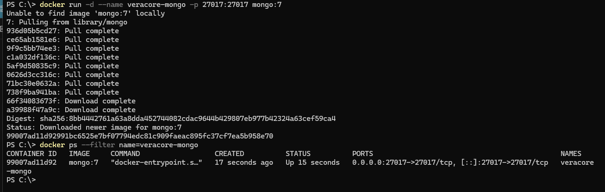
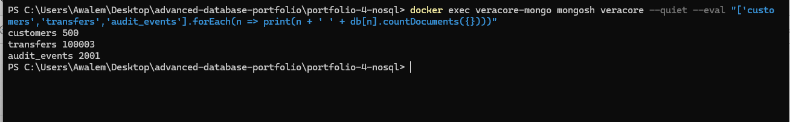
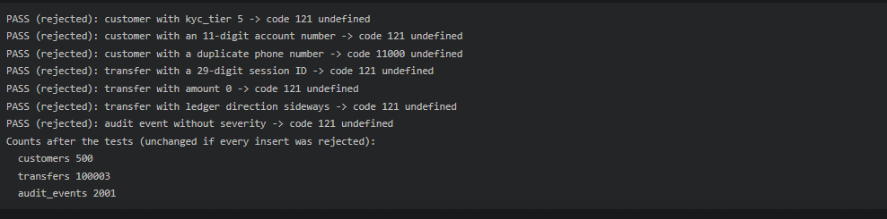
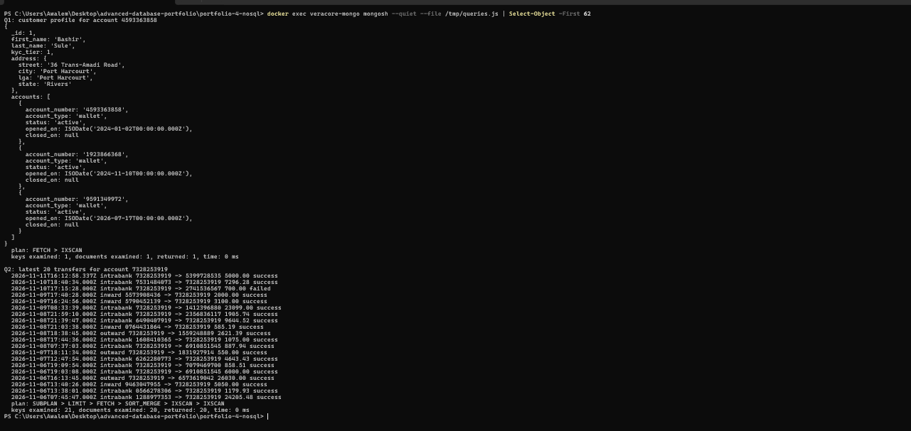
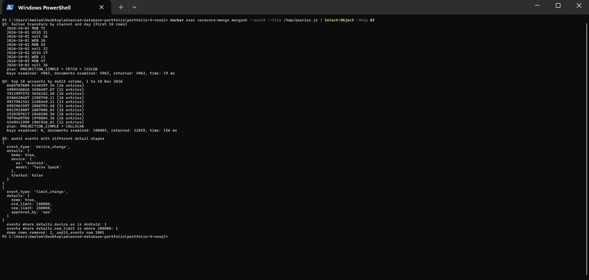

# Portfolio 4: NoSQL and Advanced Models

This portfolio models part of the Veracore MFB case study in MongoDB. The data comes from the PostgreSQL database built in Portfolio 1, so both databases describe the same bank. The screenshots are in `screenshots/`.

## Setup

MongoDB 7 runs in a single Docker container on my machine:

```
docker run -d --name veracore-mongo -p 27017:27017 mongo:7
```



The mongosh scripts were run by copying the file into the container with `docker cp` and running `mongosh --file`. The model script was the exception: I piped it into mongosh, which is why its output echoes every line.

## What goes in MongoDB and what stays in PostgreSQL

I did not move the whole schema. Three parts of the case study suit documents, and one part does not.

| Data | Where | Reason |
|---|---|---|
| Customer profile and accounts | MongoDB `customers` | Reads ask for a customer and all their accounts together. One document answers that without a join. |
| Transfers with their ledger entries | MongoDB `transfers` | An account history screen reads a transfer and its entries together. An entry belongs to exactly one transfer and each transfer has one or two of them, so the embedded array stays small. |
| Audit events | MongoDB `audit_events` | The `details` content differs by event type, which fits a flexible document better than a text column. |
| The ledger as the source of truth | PostgreSQL | It needs multi-row ACID transactions, foreign keys to accounts, monthly partitions, no UPDATE or DELETE for the application roles, and balances derived from the entries. Portfolio 3 showed these transactions and the locking that protects them. |

The MongoDB collections are a read model copied from PostgreSQL. They are not kept in sync after the copy.

## Document model

Full definitions with validation rules are in `Awa_Emmanuel_301914400_P4_Model.js`.

**customers.** `_id` is the PostgreSQL `customer_id`. The address is an embedded object. `accounts` is an array of objects holding `account_number`, `account_type`, `status`, `opened_on` and `closed_on`. Accounts are embedded because a customer has a few of them and they are always read with the customer.

**transfers.** `_id` is the 30-digit session ID, so the rule that a session ID is never reused across intrabank, inward and outward transfers is enforced by MongoDB's own unique `_id`. `transfer_type` says which of the three kinds it is. Outward and inward transfers carry an embedded `institution` object and the beneficiary or sender name. `ledger_entries` holds the debit and credit entries, with amounts stored as `Decimal128` so money is not held in floating point.

**audit_events.** Fixed fields for type, severity, time, customer and IP address, and a `details` object that can have any shape.

Indexes:

| Collection | Index |
|---|---|
| customers | unique `phone`; unique `accounts.account_number` |
| transfers | `sender_account, created_at desc`; `destination_account, created_at desc`; `status, created_at desc` |
| audit_events | `customer_id, occurred_at desc`; `event_type, occurred_at desc` |

## Loading the data

`Awa_Emmanuel_301914400_P4_LoadData.py` reads the PostgreSQL tables and writes the documents. Result:



| Collection | Documents |
|---|---|
| customers | 500 |
| transfers | 100,003 |
| audit_events | 2,001 |

The transfer count includes the three transfers committed in Portfolio 3. The audit event count includes the row inserted in the Portfolio 3 isolation test.

## Validation tests

`Awa_Emmanuel_301914400_P4_ValidationTests.js` tries seven inserts that should fail. All seven were rejected and the collection counts did not change. Code 121 is a schema validation failure and 11000 is a duplicate key.



| Test | Result |
|---|---|
| customer with kyc_tier 5 | rejected, 121 |
| customer with an 11-digit account number | rejected, 121 |
| customer with a duplicate phone number | rejected, 11000 |
| transfer with a 29-digit session ID | rejected, 121 |
| transfer with amount 0 | rejected, 121 |
| transfer with ledger direction `sideways` | rejected, 121 |
| audit event without severity | rejected, 121 |

## Queries

The queries are in `Awa_Emmanuel_301914400_P4_Queries.js`. The plan and counts come from `explain('executionStats')`.

| Query | Plan | Documents examined | Returned | Time |
|---|---|---|---|---|
| Q1: customer profile by account number | FETCH, IXSCAN | 1 | 1 | 1 ms |
| Q2: latest 20 transfers for an account, as sender or destination | SUBPLAN, LIMIT, FETCH, SORT_MERGE, two IXSCAN | 20 | 20 | 1 ms |
| Q3: failed transfers by channel and day | PROJECTION_SIMPLE, FETCH, IXSCAN | 4,963 | 4,963 | 24 ms |
| Q4: top 10 accounts by debit volume, 1 to 10 Nov 2026 | PROJECTION_SIMPLE, COLLSCAN | 100,003 | 22,859 | 331 ms |





**Q1 and Q2.** The unique index on `accounts.account_number` finds the customer directly. Q2 uses the two transfer indexes for the sender and destination branches and merges them in date order, so it reads 20 documents for 20 rows. The account's own history is one collection and needs no join across the three PostgreSQL transfer tables.

**Q3.** The `status` index finds the failed transfers, and the grouping by channel and day is done in the pipeline. The `null` channel rows are inward transfers, which have no channel in the schema.

**Q4.** This pipeline has no usable index. It scans all 100,003 transfer documents, unwinds the embedded entries and groups them by account. I did not add an index for it. In Portfolio 2 the same question against the PostgreSQL ledger (Q3 there) ran in about 21 ms. The two numbers are not a like-for-like benchmark, since MongoDB runs in Docker and the data is shaped differently, but they support keeping ledger totals in PostgreSQL.

**Q5.** Two audit events with different `details` shapes were inserted into the same collection. One has a nested device object and the other has limit fields. Both could be queried by their own fields (`details.device.os` and `details.new_limit`). Both rows were then deleted and the count returned to 2,001. In PostgreSQL this would need a `jsonb` column or a text field.

## Limits

- The MongoDB data is a one-time copy. There is no process that keeps it in step with PostgreSQL, so it goes stale as new transfers are posted.
- Validation checks the shape of one document. It cannot check that an account number in a transfer exists in `customers`, and it cannot check that debits equal credits. PostgreSQL enforces the account link through foreign keys, and neither database checks that debits equal credits for a transfer.
- MongoDB runs as one container. Replication and sharding are covered in Portfolio 5.
- Q4 was not optimised.
