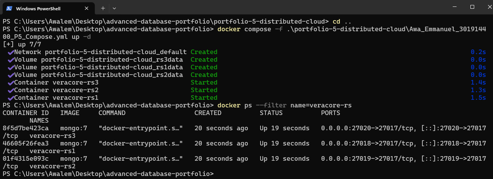
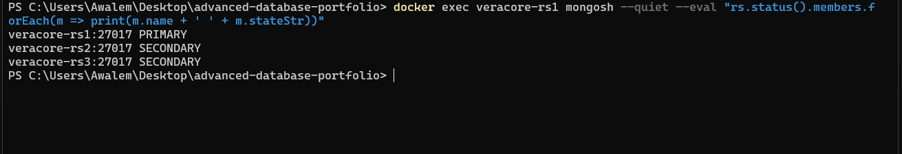
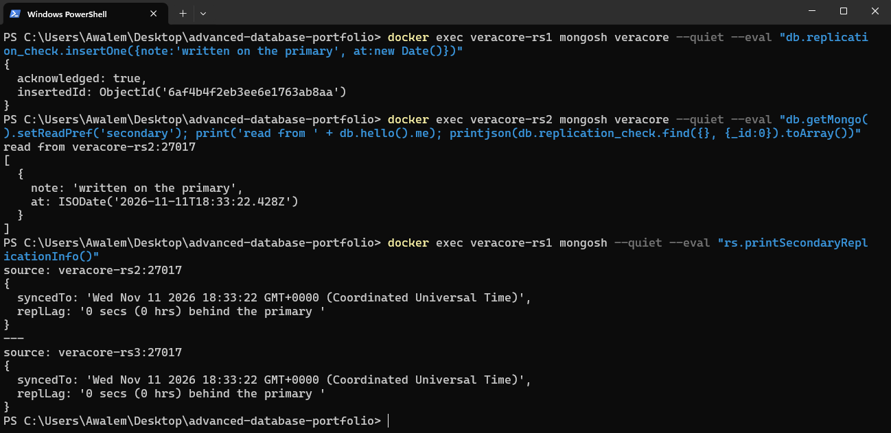
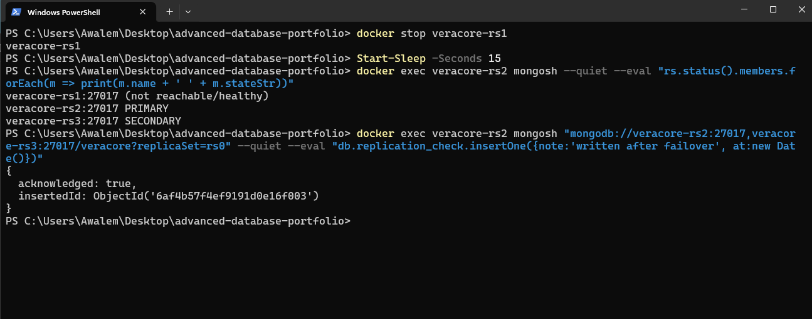
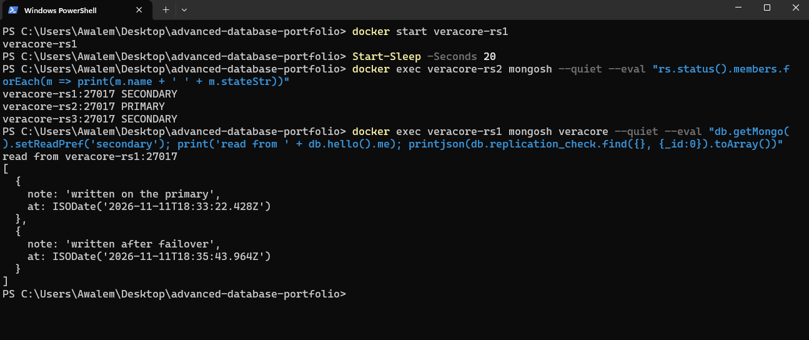
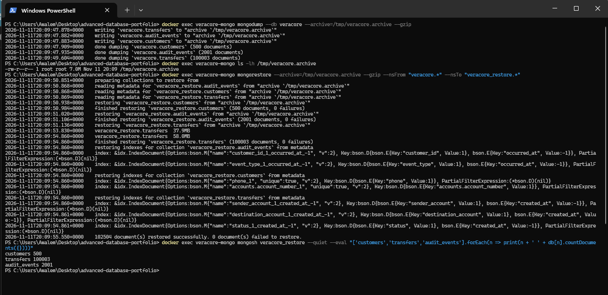

# Portfolio 5: Distributed and Cloud Databases

This portfolio covers replication, availability, consistency, backup and restore for the Veracore MFB case study. Replication, failover, and backup and restore were run on my machine with MongoDB in Docker. Sharding and the cloud deployment are design discussion only. They were not run or deployed. The screenshots are in `screenshots/`.

## Replica set

`Awa_Emmanuel_301914400_P5_Compose.yml` starts three MongoDB 7 containers, `veracore-rs1`, `veracore-rs2` and `veracore-rs3`, on ports 27018, 27019 and 27020. Each has its own data volume. I started them with:

```
docker compose -f .\portfolio-5-distributed-cloud\Awa_Emmanuel_301914400_P5_Compose.yml up -d
```



I joined them into a replica set called `rs0` with `rs.initiate`, naming the three containers as members. After a short wait `rs.status()` showed `veracore-rs1` as `PRIMARY` and the other two as `SECONDARY`.



## Replication and lag

I inserted one document into a test collection through the primary, then read it back through `veracore-rs2` with the read preference set to `secondary`. The secondary returned the document and the output names the node that answered. `rs.printSecondaryReplicationInfo()` then reported both secondaries as 0 seconds behind the primary. That command reports whole seconds, so it shows lag under one second but not how much under.



This test used one small document on an idle set. It says nothing about lag under a heavy write load.

## Failover

I stopped the primary with `docker stop veracore-rs1`, waited 15 seconds and checked the status from `veracore-rs2`. `veracore-rs1` showed as not reachable, `veracore-rs2` had been elected `PRIMARY` and `veracore-rs3` stayed `SECONDARY`. I then wrote a document through a connection string naming `veracore-rs2` and `veracore-rs3` and the replica set. The driver found the new primary and the write was acknowledged.



I then ran `docker start veracore-rs1`. After 20 seconds it had rejoined as `SECONDARY`, with `veracore-rs2` still primary. Reading from `veracore-rs1` returned both documents, including the one written while it was down, so it caught up after the restart.



I only checked the status after 15 seconds, so I know the election finished within that time but not how quickly. With one of three members down, the other two form a majority and can elect a primary. A replica set needs a majority of its voting members to have a primary, so losing two of the three would leave no primary and no writes. I did not test that case.

## Backup and restore

I backed up the Veracore database from the single-node `veracore-mongo` container with `mongodump` into a compressed archive of 7.0 MB. I restored it into a separate database, `veracore_restore`, so the live data was not touched.



The restore reported 102,504 documents restored and 0 failures. It also rebuilt the indexes from the backup metadata. Counts in the restored copy were customers 500, transfers 100003 and audit_events 2001, matching the original.

The limits of this test are that the backup was taken while nothing was writing to the database, it stayed on the same host and inside the container, and there is no point-in-time recovery. A real deployment would keep copies off the host and test restores on a schedule.

## Sharding design (not run)

The transfers collection is the one that would outgrow a single replica set, because it gains documents with every payment. The shard key must spread writes and keep common reads on few shards.

| Candidate key | Effect |
|---|---|
| `created_at` alone | Every new transfer lands on the newest range, so one shard takes all the writes. Rejected. |
| hashed `_id` (the session ID) | Writes spread evenly, but an account history query has to ask every shard. |
| `sender_account`, then `created_at` | Writes spread across accounts. A query for an account's sent transfers goes to one shard and is already in date order. |

I would choose `{ sender_account: 1, created_at: 1 }`. The `created_at` part lets the chunks of a very busy account split by time. The cost is that queries by `destination_account`, like the second branch of Q2 in Portfolio 4, would be sent to all shards. Customers and audit events would not be sharded at first. Customers is small and read by account number, and audit events could be archived by age before sharding is needed.

## Consistency and availability position

The ledger stays in PostgreSQL on a single primary. For moving money the bank needs a correct balance more than it needs a write to succeed during a failure, so it should refuse the write over taking a wrong one. This is the ACID side, as Portfolio 3 showed with the locking on balance checks.

The MongoDB collections are a read model copied from PostgreSQL, so they can lag behind it. That is acceptable for statement history and audit search, and it follows the BASE style: the data is available and becomes consistent shortly after the source changes. It would not be acceptable for checking a balance before a withdrawal. A MongoDB replica set favours consistency in a partition: only the side holding a majority can accept writes. Reads from a secondary, as in the replication test, can return slightly old data.

## Cloud deployment mapping (not deployed)

| Component | Cloud option | Reason |
|---|---|---|
| PostgreSQL ledger | Managed PostgreSQL with a standby in a second availability zone and automated backups | Single primary, automatic failover, point-in-time recovery |
| MongoDB read model | A managed three-node replica set spread over three availability zones | The same layout as the test, with one node per zone |
| Backups | Scheduled snapshots stored in a second region | A copy that survives the loss of one region |

Where the data may be hosted is also a regulatory question for a Nigerian bank. I have not checked those rules, so I have not named a region.

## Limits

- Failover and replication were tested on one machine with Docker, so there is no real network delay or partition.
- No test was run with more than one node down.
- Sharding and the cloud deployment are discussed, not built.
- The replica set holds only the small test collection. The Veracore data is in the separate single-node container.
